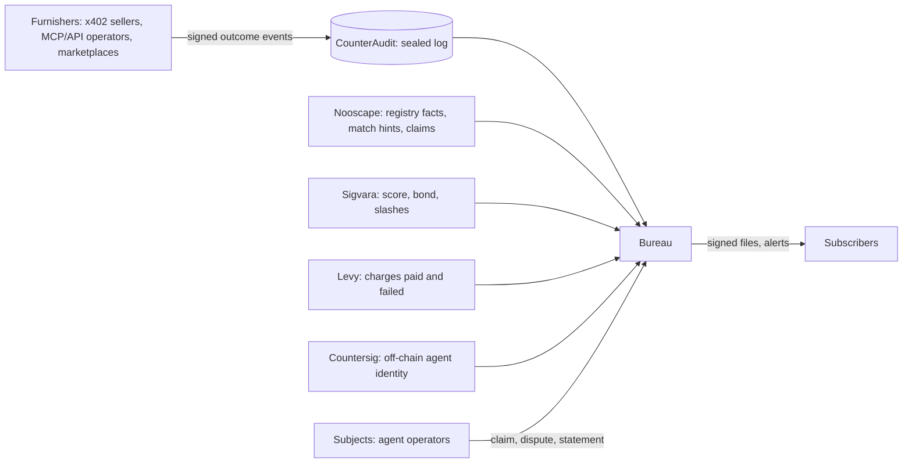

# The Agent Bureau

One file per agent operator, across chains, built from outcomes that other businesses report.

```
Owner:      David (RunTimeAdmin)
Status:     Draft for review
Created:    2026-10-26
Supersedes: AgentClear as a product name. Its Levy and Sigvara mainnet phases still apply.
```

## Objective

Give anyone about to pay, serve or extend terms to an AI agent a dated, evidence-backed file on the operator behind it, built mostly from outcomes that third parties report and that no public chain shows.

## Background

Agents now pay and get paid on their own, over x402 and through ERC-8004 registries. Agents that pay with cards are covered by identity schemes (Visa Trusted Agent Protocol, Mastercard Agent Pay) and merchant fraud scoring (Forter, HUMAN, Experian Agent Trust). Wallet-native agents on Arc, Base, Solana, BNB Chain and Robinhood Chain mostly have registry explorers.

We already run most of the parts:

- **Nooscape:** a public atlas of 42,591 listed agents on five chains (as of 2026-10-22), with dated facts, Ed25519-signed evidence packets, owner claims, watchlists with signed webhooks, and a paid `/check` at $0.01 over x402.
- **Sigvara:** a reputation layer over ERC-8004 on Arc testnet. It computes a score, holds bonds, executes slashes, and its pull scanner credits on-chain payments to registered sellers.
- **CounterAudit:** sealed, hash-chained, RFC 3161-timestamped event ingest.
- **Levy:** USDC subscription billing on Arc testnet that records paid and failed charges on-chain.
- **Countersig:** hosted agent identity, Ed25519 auth and egress policy.

What's missing is what makes a credit bureau worth paying for: outcome data furnished privately by many parties (who paid, who delivered, who got cut off), matching records to one operator, and a way to contest a record. Public registry data is free for anyone to index, so a file built only from it is an explorer, and several explorers already exist.

AgentClear (spec v0.3) wired identity, billing, reputation and audit into one loop, but stopped short of third-party data and of a product an outsider pays for. The Bureau is that product. Traction so far is thin: as of 2026-10-03 AgentClear recorded zero Levy plans and about $1 of arm's-length x402 volume across 78 listings in 17 days. That is why this spec starts with a 90-day test done by hand.

## Goals

1. Before transacting, a subscriber can see whether an agent's operator has a record of paying, delivering and staying within policy with other businesses.
2. Most files that subscribers pull contain at least one fact that no public chain shows.
3. Every line on a file traces to its evidence, and its subject can contest it.
4. The Bureau adds one product, not another stack. It reuses Nooscape, Sigvara, CounterAudit, Levy and Countersig, because one person maintains all of them.

## Non-goals

- **No Bureau score or verdict.** A file states facts with dates and sources. Sigvara's score appears as a labeled third-party fact. Subscribers set their own thresholds. This keeps Nooscape's rule: facts, never a verdict.
- **No identity verification of people.** Visa, Mastercard, Persona and Experian own that. The Bureau only vets its furnishers.
- **No card-rail agents.** Wallet-native agents only.
- **Not a consumer report.** Files describe agents and the businesses operating them, not a person's creditworthiness. See Privacy and legal.
- **No token, no new chain, and no on-chain writes by the Bureau in v1.**
- **No change to Nooscape's public records.** Furnished data never appears on nooscape.si.

## Terms

| Term | Meaning |
| --- | --- |
| Subject | An agent operator: one or more agent registrations matched to the same controller. |
| File | Everything the Bureau holds on a subject, as of a given time. |
| Furnisher | A business that reports outcomes about agents it dealt with. |
| Subscriber | Anyone who pulls a file before transacting. Usually also a furnisher. |
| Outcome event | One furnished fact: an agent paid, failed to pay, delivered, was disputed, was cut off. |
| Inquiry | A record that a subscriber pulled a subject's file. |

## How it sits over the existing systems



| System | What the Bureau reads | What the Bureau never does |
| --- | --- | --- |
| Nooscape | Registrations, first seen, registry events, ownership changes, share of ratings revoked, evidence level, owner claims, candidate matches (shared wallet, host, link) | Show furnished data on Nooscape, or let a payment or furnished event change a Nooscape record |
| Sigvara | Current score, bond, slash history, and which network they come from | Compute, adjust or attest to the score |
| CounterAudit | The system of record for every furnished event, dispute and correction. Packet ids are the evidence pointers on a file. It also holds the furnisher signing keys the Bureau registers, and seals only events those keys verify. | Store anything outside the sealed chain |
| Levy | Subscription charges paid and failed, read from chain | Charge, retry or block anything |
| Countersig | DIDs and keys for agents with no registry entry | Issue identities on the Bureau's behalf |

## What a file contains

Every field carries `as_of`, `source` and an evidence pointer.

| Section | Contents | Source |
| --- | --- | --- |
| Subject | Matched registrations (chain, registry, id), wallets, endpoint hosts. Each match states its basis: same owner wallet, signed claim, or Countersig DID. | Nooscape, Countersig, subject claims |
| Possible matches | Registrations that share a host or link but aren't confirmed. Listed separately, never merged. | Nooscape |
| Public record | First seen, registry events, ownership changes, share of ratings revoked, evidence level | Nooscape |
| Payment history | As seller: on-chain payments received (count, volume, distinct payers, last 90 and 365 days). As payer: Levy charges paid and failed. | Sigvara scanner, Levy |
| Furnished outcomes | Counts by outcome type and window, number of distinct furnishers, furnisher category. Each line links to its sealed packet, and unsigned pilot events are labeled. | Furnishers via CounterAudit |
| Third-party standing | Sigvara score, bond and slashes, labeled with network | Sigvara |
| Disputes and statements | Open and closed disputes with results, plus the subject's own statement (up to 500 characters) | Bureau |
| Inquiries | Pulls in the last 90 days, by subscriber category | Bureau |
| Not on file | What the Bureau could not see, e.g. Circle Gateway-batched x402 settlement and chains Nooscape doesn't index | Bureau |

No field rolls these up into a score, grade or recommendation.

Furnisher names are always shown to the subject, so they can dispute. Subscribers see only the furnisher's category ("x402 API seller", "MCP server operator", "marketplace") unless the furnisher opts in to being named.

Retention (proposed): outcome events leave the file after 24 months. Lines removed by a dispute leave at once. The sealed log in CounterAudit keeps everything for audit.

## Furnishers

### Who, in order of how fast they can start

1. **Our own systems**, labeled as such: Levy charge outcomes, Countersig egress-policy blocks, audited outcomes from CounterAudit customers. These prove the pipeline but don't count toward the test.
2. **x402 sellers** (APIs and MCP servers charging per call), starting with the sellers AgentClear found behind the vanilla-x402 listings.
3. **MCP and API operators** that block or rate-limit agents.
4. **Agent marketplaces** that hire agents for jobs, reporting delivered, late and disputed work.

### What they report: outcome event v1

The format and the signing tool live in the public repo [RunTimeAdmin/agent-bureau-furnish](https://github.com/RunTimeAdmin/agent-bureau-furnish) (MIT). Furnishers run it with `npx github:RunTimeAdmin/agent-bureau-furnish`, nothing to clone. Its generated JSON Schema is copied to `client/public/schemas/outcome-event-v1.json` here, so the site serves it at https://theagentbureau.xyz/schemas/outcome-event-v1.json; copy it again whenever the package's schema changes. The earlier v0 schema stays at `outcome-event-v0.json` for files signed before v1, but CounterAudit accepts only v1, because without `key_id` a key cannot be rotated or revoked.

| Field | Required | Notes |
| --- | --- | --- |
| `schema_version` | yes | `"1"` |
| `furnisher_id` | yes | Issued when the furnisher is vetted: `fur_` plus 6 to 32 lowercase letters or digits |
| `key_id` | yes | The name the furnisher gave the key that signed the event, registered with its public key: up to 64 letters, digits or `. _ : -` |
| `event_id` | yes | The furnisher's own reference, unique per furnisher. Disputes and corrections point at it. |
| `relation` | no | `{type, target_event_id}`: this event `disputes`, `corrects`, `supersedes` or `withdraws` an earlier `event_id` of the same furnisher |
| `subject_ref` | yes | One of: `{chain, registry, id}`, `{wallet}`, `{did}` |
| `outcome` | yes | `paid`, `payment_failed`, `delivered`, `not_delivered`, `disputed`, `refunded`, `access_revoked`, `policy_violation` |
| `occurred_at` | yes | ISO 8601, UTC, with seconds |
| `amount` | payment outcomes | `{value, asset, chain}` |
| `evidence` | negative outcomes | Transaction hash, CounterAudit packet id, or a reference to a log excerpt the furnisher keeps for 24 months |
| `signature` | yes, except pilot fallback | `ed25519:` plus base64url. Signed over `agent-bureau/outcome-event/v1\n` followed by the event without `signature` in RFC 8785 canonical JSON, with the key registered for that `furnisher_id` and `key_id` |

### Rules

- Every event lands in CounterAudit before it can reach a file. CounterAudit refuses an event whose key is not registered for its furnisher, whose signature does not verify, or that reuses an `event_id` the furnisher already used for a different event. A correction is a new event with a `relation` pointing at the old one.
- Negative outcomes (`payment_failed`, `not_delivered`, `access_revoked`, `policy_violation`) without evidence are held, not shown.
- A furnisher reports every outcome of a type for the agents it reports on, good and bad. Reporting only negatives gets the furnisher dropped. Credit bureaus require complete reporting for the same reason.
- **Pilot fallback, unsigned CSV.** During the 90-day pilot only, a furnisher that hasn't set up signing can send an unsigned CSV through a channel agreed at onboarding, either email from its registered contact with DKIM passing or a private upload link issued to it. The Bureau runs `furnish check` on the file and seals it in CounterAudit together with the channel details. Files label those events "unsigned". After the pilot, signatures are required.

### Terms (hypotheses to test, not final)

| | The furnisher gets | The furnisher gives |
| --- | --- | --- |
| Reciprocity | Free file pulls (proposed: 1 per 10 accepted events a month, capped) and alerts on agents it reported on | Complete, accurate reporting; evidence for negatives; a reply to disputes within 15 days; corrections within 5 days |
| Data rights | Its events are licensed to the Bureau for files only: never resold raw, never published on Nooscape | A warranty that it may share the data under its own terms of service |
| Leaving | Can stop at any time. Past events stay until they age off or are disputed. | Nothing further |

**Vetting:** every outside furnisher is a real business we have spoken to, with a website and a named contact. We register its signing key and record its own wallets, so events where a furnisher reports on its own agents get flagged.

## Subscribers

- **Who:** the same parties as furnishers, plus marketplaces vetting providers and businesses admitting outside agents.
- **How:** an API call or an MCP tool (extend `nooscape-mcp` or ship a small bureau tool). Every served file is signed with a published Bureau key, the same way Nooscape signs evidence packets.
- **Price (hypothesis):** $0.25 per file over x402, or a monthly plan. Furnishers pull free under reciprocity. Nooscape's $0.01 `/check` stays as the public-record lookup.
- **Alerts:** signed webhooks when a watched subject gets a new negative outcome, dispute or slash, reusing Nooscape's watchlist and webhook code.
- **Permitted use:** deciding whether, and on what terms, to transact with an agent. Never for decisions about a person's consumer credit, employment, insurance or housing. The subscriber terms say so.

## Disputes

A subject disputes by proving control of the agent, the same way Nooscape claims work today: one message signed by the wallet that owns the registration. A furnisher can correct or withdraw its own events at any time.

1. The subject disputes a specific line, with an optional explanation and evidence.
2. The line is marked "disputed" on the file at once.
3. The furnisher has 15 days to confirm it with evidence, correct it or withdraw it. Where the evidence is on-chain, the Bureau checks it directly.
4. If the furnisher doesn't confirm in time, or the evidence doesn't hold, the line is removed. If it is confirmed, it stays, marked "disputed, confirmed by furnisher", and the subject can attach a statement.
5. Every step is sealed in CounterAudit. The subject sees the result and the reason.
6. The target is 30 days end to end.

Sigvara slashes and Nooscape records are contested through their own processes. The Bureau shows the result and links there. Lines a furnisher fails to support count against that furnisher; repeated failures get it dropped.

## Security

- **Trust boundaries:** furnisher input is untrusted until its signature and evidence checks pass. A subject's claim is trusted only for linking registrations its signing wallet controls.
- **Sybil furnishers:** one operator could pose as several furnishers to pump or smear an agent. Defences are vetting every furnisher, showing distinct-furnisher counts rather than event counts, and flagging events where furnisher and subject wallets link.
- **Scraping:** files are priced per pull, and every inquiry is logged and visible to the subject.
- **Keys:** furnisher keys can be revoked. The Bureau's signing keys are published and rotated like Nooscape's.

## Privacy and legal

- Wallet addresses, hosts and claims can identify a person. Where an operator is an individual, treat the file as personal data under GDPR: legitimate interest as the lawful basis, free access to one's own file, correction through disputes, and 24-month retention.
- In the US, a file used to decide whether to extend credit to an identifiable person can make the Bureau a consumer reporting agency under the FCRA. Mitigations: files cover agents and the businesses operating them; subscriber terms ban consumer-purpose use; there are no scores or eligibility decisions. **Have counsel review this before the first paying subscriber.** Until then, public copy says "Bureau file", never "credit report" or "credit score".
- A furnished negative can hurt a business's reputation. Evidence requirements and the dispute process are the defence, so neither is optional.

## The 90-day furnisher test

The bet only works if outsiders furnish data. Test that first, by hand, before building the service.

**Weeks 1 to 2:** write the furnisher one-pager and terms, outcome event v0 as a JSON schema, a signed-upload script that writes into CounterAudit, and a script that assembles a file from Nooscape, Sigvara, Levy and CounterAudit data.

**Weeks 3 to 8:** recruit from a list of 25 candidates across x402 sellers, MCP and API operators, and marketplaces. Offer free files for the test period.

**Weeks 6 to 12:** furnishers send events by script or CSV. Subscribers request files by email or a simple form, and we assemble and send signed files by hand. Run one dispute end to end as a drill.

Only arm's-length parties count. Our own projects, and anyone we pay, don't.

| Measure, tracked weekly | Day 45 checkpoint | Day 90 pass |
| --- | --- | --- |
| Furnisher conversations held | 10 | 25 |
| Outside furnishers committed or live | 1 signed letter of intent | 3 live |
| Accepted outside events | any | 200 |
| Files pulled by someone other than us | any | 25 |
| Pulled files with at least one fact no public chain shows | n/a | 50% |
| Paying subscribers | n/a | 1 |
| Dispute drill completed | n/a | 1 |

**Outcomes:**

- **Pass:** decide Open issue 1, get the legal review, set prices, then build the service.
- **Day 45 checkpoint missed** (no furnisher committed after 10 conversations): write down why, then decide whether to continue.
- **Day 90 fail** (fewer than 3 outside furnishers live): it's an explorer, not a bureau. Fold the useful parts, matching and the file view, into Nooscape and stop the Bureau product.

## Open issues

1. **Where the service runs.** (a) A private tier inside the Nooscape service, reusing its ingestion, matching, keys, x402 and webhooks, with furnished data in separate tables. (b) A separate service that reads Nooscape's API. (a) is less code for one maintainer; (b) separates public and private data more cleanly. Proposed: (a), with a hard rule that public endpoints never read Bureau tables. Decide after the test.
2. **Naming furnishers to subscribers.** Proposed: opt-in. Decide with the first furnishers.
3. **Prices.** $0.25 per file and the 1-in-10 reciprocity ratio are guesses. Revisit at day 45 with real conversations behind them.
4. **Testnet scores.** Sigvara runs on Arc testnet with no external audit, and mainnet is planned for Q1 2027 behind one (AgentClear Phase 0, decision 3). Proposed: show the score, labeled with its network.
5. **Known blind spots.** Sigvara's scanner can't see Circle Gateway-batched x402 settlement, and Levy charges show the SubscriptionManager as payer (AgentClear F3). Both go under "Not on file" until fixed.
6. **Legal review.** Who, and when. Proposed: before the first paying subscriber.
7. **The website.** Should theagentbureau.xyz switch from the services pitch to this? Proposed: yes. The furnisher one-pager (`docs/furnisher-one-pager.md`) now exists and becomes the main page.

## Resolved issues

- **Getting the signing tool to furnishers** (decided 2026-10-26). The tool started in this private repo, where outside businesses couldn't run it. Options were (a) publish it, (b) accept unsigned CSV during the pilot, or (c) both. Chose (c): the tool is public at [RunTimeAdmin/agent-bureau-furnish](https://github.com/RunTimeAdmin/agent-bureau-furnish), and unsigned CSV is the pilot fallback described under Furnishers, Rules.

## Alternatives considered

- **A services storefront** (investigations using our tools): faster revenue, but no data asset that compounds. Still available if the test fails.
- **A Bureau score:** what lenders expect, but it invites the FCRA question, breaks Nooscape's rule, and is the easiest part for a competitor to copy. Matched records and furnished evidence are harder to copy.
- **Public registry data only:** cheaper, but anyone can index ERC-8004 registries, and several explorers already do.
- **Card-rail agents:** a bigger market, held by Visa, Mastercard and the fraud vendors.

## Related documents

- Outcome event format and signing tool: https://github.com/RunTimeAdmin/agent-bureau-furnish
- Furnisher one-pager: `docs/furnisher-one-pager.md`
- AgentClear build spec v0.3: `RunTimeAdmin/agentclear`, `SPEC.md`
- Sigvara white paper and reputation model: `RunTimeAdmin/Sigvara`, `docs/whitepaper.md` and `docs/reputation-model.md`
- Nooscape API: https://nooscape.si/api/v1/openapi.json
- CounterAudit API: `RunTimeAdmin/CounterAudit`, `openapi.yaml`
- The original Bureau MVP plan and Solana rollout notes (kept outside this repo). Where they differ, this document wins.
